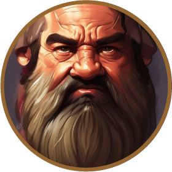
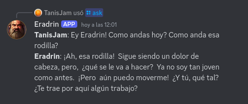
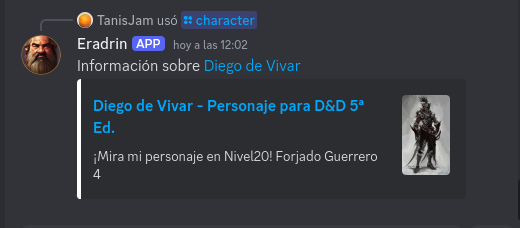
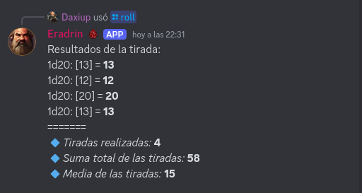
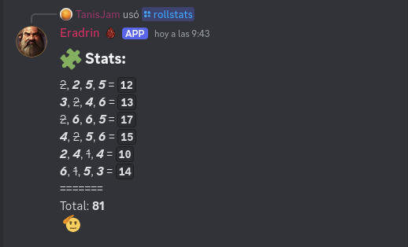

<div align="center">


# Eradrin Bot

Discord bot for role-playing games management and social activities.

## Project Structure

The application follows a modular and well-defined architecture:

```
src/
├── commands/           # Discord commands 
├── database/           # Database configuration and models
│   └── models/         # Sequelize models
├── services/           # Business logic services
├── types/              # TypeScript interfaces and types
├── utils/              # Utilities and helper functions
├── bot.ts              # Main bot entry point
├── config.ts           # Global application configuration
└── deploy-commands.ts  # Script to register commands in Discord
```

## Architecture

- **Model-View-Controller (MVC)**
  - **Models**: Data representations in `database/models/`
  - **Views**: User responses through Discord
  - **Controllers**: Command logic in `commands/`

- **Modular Approach**
  - Each command is independent
  - Services handle reusable business logic
  - Utilities provide common functions

## Available Commands

- `/ping`: Responds with "Pong" and shows usage statistics
- `/ask`: Allows asking questions using AI with RAG (Retrieval-Augmented Generation)
- `/character`: Character management and search on Nivel20
- `/roll`: Dice rolling using RPG Dice Roller
- `/rollstats`: Rolling statistics for character creation
- `/help`: Shows help for available commands
- `/bonk`: Turn-based combat system
- `/impersonate`: Character impersonation with AI
- `/summary`: Generates text summaries
- `/rolreset`: Reset user roles

## Technologies Used

- **Node.js**: Runtime environment
- **TypeScript**: Typed programming language
- **Discord.js**: Library to interact with Discord API
- **Sequelize**: ORM for the database
- **SQLite**: Local database
- **Google Gemini AI**: AI model for chatbot and RAG functionality
- **RPG Dice Roller**: Comprehensive dice rolling library

## Configuration and Development

### Prerequisites

- Node.js 16.x or higher
- PNPM (recommended) or NPM

### Environment Variables

Create a `.env` file based on `.env.example`:

```
CLIENT_ID=your_discord_client_id
TOKEN=your_discord_bot_token
GUILD_ID=your_discord_server_id
GEMINI_API_KEY=your_gemini_api_key
```

### Installation

```bash
# Install dependencies
pnpm install

# Compile TypeScript
pnpm build

# Register commands in Discord
pnpm deploy-commands

# Start the bot
pnpm start
```

### Running with Docker

```bash
# Build image
docker build -t eradrin-bot .

# Run container
docker run -d --name eradrin-bot eradrin-bot
```

Or using Docker Compose:

```bash
docker-compose up -d
```

## Implemented Best Practices

- **Strong Typing**: Extensive use of TypeScript to prevent errors
- **Error Handling**: Error capture and logging for easier debugging
- **Modularity**: Independent and easily replaceable components
- **Documentation**: Code documented with JSDoc and detailed README
- **Centralized Configuration**: Environment variables and configuration in one place
- **Logging**: Logging system for easier monitoring and debugging

## Contributions

Contributions are welcome. Please follow these steps:

1. Fork the repository
2. Create a branch for your feature (`git checkout -b feature/amazing-feature`)
3. Commit your changes (`git commit -m 'Add some amazing feature'`)
4. Push to the branch (`git push origin feature/amazing-feature`)
5. Open a Pull Request

## License

This project is licensed under the MIT License - see the LICENSE file for details.

</div>

# ✨ Features

> - **Chatbot**: Uses the Gemini AI API to answer user questions.
>
> 


>- **Search for characters**: Provides quick and direct links to character sheets on Nivel20.
>
>

>- **Roll dice**: Provides comprehensive and accurate dice rolls using [RPG Dice Roller](https://github.com/dice-roller/rpg-dice-roller)
>
>

>- **Random Stats**: Rolls random stats for character creation.
>
>


# 📦 Requirements

- Node.js
- Discord Bot Token
- Gemini AI API Key
- **`.env`** file with the following variables:
  - **`CLIENT_ID`**
  - **`TOKEN`**
  - **`GUILD_ID`**
  - **`GEMINI_API_KEY`**

# ⚡️ Quick start

1. Clone this repository:

   `git clone https://github.com/your-username/eradrin-bot.git
cd eradrin-bot`

2. Install the dependencies:

   `npm install`

3. Create a **`.env`** file in the root of the project and add your credentials:

```bash
CLIENT_ID=12345678901234567890
TOKEN=123456789qwertyuiop
GUILD_ID=12345678901234567890
GEMINI_API_KEY=123456789qwertyuiop
```

4. Build the project:

   `npm run build`

5. Start the bot:

   `npm start`

6. Deploy commands:

   `npm run deploy:commands`

# 🛎️ Available Commands

### `/ask`
- **Description**: Ask Eradrin something.
- **Options**:
  - `question` (string, required): The question you want to ask Eradrin.

### `/character`
- **Description**: Receive information about a character.
- **Options**:
  - `name` (string, required): Name of the character.

### `/ping`
- **Description**: Replies with "Pong!".

### `/roll`
- **Description**: Roll some dice.
- **Options**:
  - `dice` (integer, required): The die to roll.
    - **Available options**:
      - `d2` (2)
      - `d4` (4)
      - `d6` (6)
      - `d8` (8)
      - `d10` (10)
      - `d12` (12)
      - `d20` (20)
      - `d100` (100)
  - `number` (integer, optional): The number of dice to roll.
  - `mod` (integer, optional): The modifier to add to the result.
  - `dc` (integer, optional): The difficulty of the roll.
  - `iterations` (integer, optional): The number of times to repeat the roll.
  - `advantage` (string, optional): Whether the roll is with advantage or disadvantage.
    - **Options**:
      - `advantage` (adv)
      - `disadvantage` (dis)

### `/rollstats`
- **Description**: Generates stats for your next character (or sends you to point buy).

### `/bonk`
- **Description**: Start a turn-based combat with another user.

### `/impersonate`
- **Description**: Impersonate a character using AI.

### `/summary`
- **Description**: Generate summaries of text or conversations.

## 🧠 RAG (Retrieval-Augmented Generation)

Eradrin Bot uses RAG to enhance AI responses with custom knowledge:

### Setting Up Knowledge Base

1. Add text files to `knowledge/` directory organized by category:
```
knowledge/
  ├── player-characters/
  │   ├── character1.txt
  │   └── character2.txt
  └── stories/
      └── campaign.txt
```

2. Ingest knowledge into the database:
```bash
# Process all knowledge files
pnpm ingest-knowledge -- --mode=all

# Process specific directory
pnpm ingest-knowledge -- --mode=directory --directory=player-characters

# Process single file
pnpm ingest-knowledge -- --mode=file --file=player-characters/character1.txt
```

3. Ask questions using `/ask` - Eradrin will search the knowledge base for relevant context!

For more details, see [README-RAG.md](./README-RAG.md).

# 🎯 Upcoming Features

I am planning to add the following features to enhance the D&D experience:

 - [x] **Dice Roller**: A feature to roll dice directly within Discord, supporting various types of dice (e.g., d20, d12, d10, d8, d6, d4).
 - [x] **Random Stats Generator**: A feature to generate random stats for character creation.
 - [ ] **Random Loot Generator**: Automatically generate loot for encounters, including items, gold, and other stuff.
 - [ ] **Plot Generator**: Create random plots for encounters or adventures.
 - [ ] **Encounter Generator**: Create random encounters with different levels of difficulty and variety of monsters.
 - [ ] **NPC Generator**: Generate random NPCs with unique names, backgrounds, and characteristics.


# 👩‍💻 Author

- [TanisJam](https://mnr.ar)
